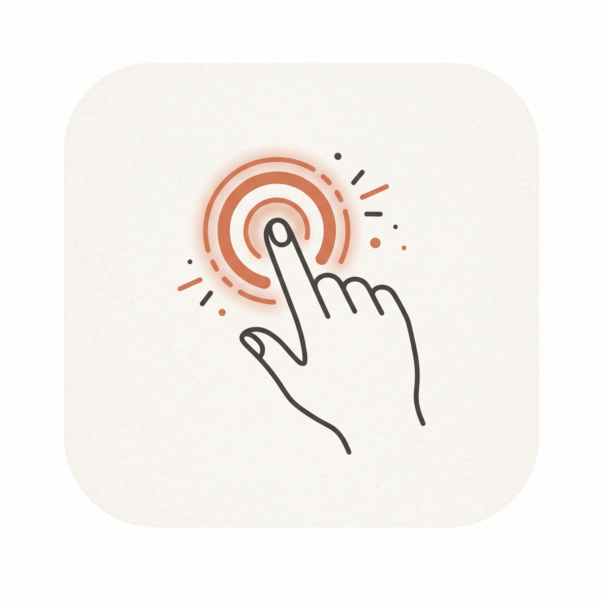
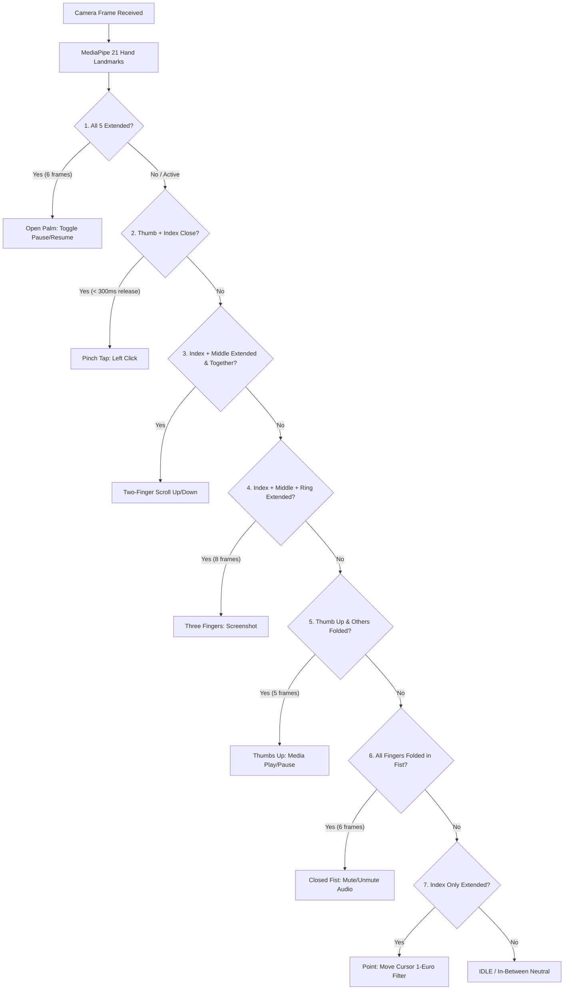

# Finger Controler 🖐️⚡

[](https://android.com)
[](https://flutter.dev)
[](https://developers.google.com/mediapipe)
[](https://kotlinlang.org)
[](#performance--architecture)
[](LICENSE)

<p align="center">
  
</p>

**Finger Controler** is an advanced, touch-free computer vision control system for Android. Utilizing real-time front-camera hand tracking with Google MediaPipe and an adaptive 1-Euro velocity-aware filter, it provides an ultra-low latency on-screen cursor and rich gesture commands across the entire operating system via native Android Accessibility Services.

---

## 🌟 Key Features

- **Global System Overlay**: Operates seamlessly over any application (browsers, social media, media players, games, home launcher).
- **Sub-Pixel Cursor Tracking**: Driven by index fingertip landmark 8, smoothed with an adaptive 1-Euro velocity filter (jitter-free stationary hold with zero-lag fast movements).
- **7 Distinct Gesture Commands**: Ergonomic hand poses designed for maximum recognition accuracy, hysteresis debouncing, and zero false positives.
- **Continuous Touchpad-Style Scrolling**: Intuitive two-finger vertical scrolling that mirrors mouse wheel action.
- **Native OS Integration**: Directly triggers media playback keys, system mute sliders, and native screen capture without requiring root.
- **Real-Time HUD Overlay**: Sleek, non-intrusive heads-up display reporting live FPS, end-to-end latency in milliseconds, active state, and recognized gesture flashes.
- **Zero-Allocation Camera Pipeline**: Front-camera processing in CameraX using pre-allocated native image buffers and live-stream inference to guarantee consistent 30 FPS.

---

## 🖐️ Gesture Commands Reference

The system implements a priority-based recognition state machine with hysteresis debouncing and neutral release confirmation:

| Gesture | Hand Pose & Landmark Rules | Action / Behavior | Visual Feedback |
| :--- | :--- | :--- | :--- |
| **Move Cursor** | **Index Finger Extended**<br>Landmark 8 tracked; Middle, Ring, Pinky folded; Thumb neutral | **Smooth Cursor Movement**<br>Sub-pixel cursor position mapped across calibrated active screen bounds | Vibrant orange precision dot with high-contrast white ring |
| **Left Click** | **Thumb + Index Pinch**<br>Normalized distance between landmarks 4 & 8 < `0.055` | **Instant Left Click**<br>Deliberate tap-and-release within 40–300 ms dispatches tap at current cursor coordinates | Cursor scale punch + expanding ripple wave + HUD `CLICK` |
| **Scroll Up / Down** | **Index + Middle Fingers Extended**<br>Landmarks 8 & 12 extended close together (`hypot < 0.065`); Ring & Pinky folded | **Continuous Vertical Scroll**<br>Vertical hand movement drives smooth scrolling (upward movement scrolls up, downward movement scrolls down) | Cursor bounce micro-animation + HUD `SCROLL ↑` / `SCROLL ↓` |
| **Pause / Resume** | **Open Palm**<br>All 5 fingers extended (`extension ratio > 1.25`) for 6 consecutive frames | **Toggle PAUSED / ACTIVE**<br>In PAUSED mode: stops cursor, clicks, scrolling, media, and screenshot actions while keeping lightweight resume tracking active | HUD status toggles `PAUSED ⏸` / `ACTIVE ▶`; cursor turns muted slate gray |
| **Media Play / Pause** | **Thumbs Up**<br>Thumb extended pointing up (`thumbTip.y < thumbMcp.y`); all other 4 fingers folded | **Play / Pause OS Media**<br>Sends OS `KEYCODE_MEDIA_PLAY_PAUSE` to active media session (Spotify, YouTube, browser, etc.) | Spring-green ripple pulse + HUD `MEDIA ⏯` |
| **Mute / Unmute** | **Closed Fist**<br>All 4 fingers folded (`ratio <= 1.10`); Thumb tucked across fingers | **Toggle System Audio Mute**<br>Toggles `STREAM_MUSIC` volume mute using native Android `AudioManager` and displays volume HUD | Coral-red ripple pulse + HUD `MUTE 🔇` |
| **Screenshot** | **Three Extended Fingers**<br>Index, Middle, and Ring extended; Thumb and Pinky folded for 8 frames | **Capture System Screenshot**<br>Dispatches Android `GLOBAL_ACTION_TAKE_SCREENSHOT` and saves full resolution screenshot to gallery | White camera shutter flash ring + HUD `SCREENSHOT 📷` |

---

## 📐 Priority Recognition & Conflict Prevention

To prevent ambiguous configurations from accidentally triggering unintended actions, gesture detection follows a strict evaluation hierarchy:



---

## ⚙️ Centralized Configuration

All thresholds, timings, smoothing parameters, and tolerances are organized in [`FingerControlerConfig.kt`](android/app/src/main/kotlin/com/example/finger_controler/FingerControlerConfig.kt):

```kotlin
object FingerControlerConfig {
    // 1. Camera & Pipeline
    const val TARGET_FPS: Int = 30
    const val CAMERA_WIDTH: Int = 640
    const val CAMERA_HEIGHT: Int = 480

    // 2. 1-Euro Filter Smoothing Parameters
    const val ONE_EURO_MIN_CUTOFF: Double = 1.2   // Jitter reduction at rest
    const val ONE_EURO_BETA: Double = 0.035        // Speed responsiveness
    const val ONE_EURO_DCUTOFF: Double = 1.0

    // 3. Open Palm (Pause / Resume)
    const val PALM_CONFIRMATION_FRAMES: Int = 6
    const val PALM_COOLDOWN_MS: Long = 1200L
    const val PALM_FINGER_EXTENSION_RATIO: Float = 1.25f

    // 4. Pinch (Left Click)
    const val PINCH_ACTIVATION_THRESHOLD: Float = 0.055f
    const val PINCH_RELEASE_THRESHOLD: Float = 0.080f
    const val PINCH_MIN_DURATION_MS: Long = 40L
    const val PINCH_MAX_DURATION_MS: Long = 300L
    const val PINCH_COOLDOWN_MS: Long = 350L

    // 5. Two-Finger Scroll
    const val SCROLL_FINGER_SEPARATION_THRESHOLD: Float = 0.065f
    const val SCROLL_MIN_DISPLACEMENT_NORMALIZED: Float = 0.016f
    const val SCROLL_SENSITIVITY: Float = 1.0f
    const val SCROLL_COOLDOWN_MS: Long = 100L
    const val SCROLL_INVERT_DIRECTION: Boolean = false // false = natural wheel up

    // 6. Media Play/Pause (Thumbs Up)
    const val MEDIA_THUMBS_UP_CONFIRMATION_FRAMES: Int = 5
    const val MEDIA_THUMBS_UP_COOLDOWN_MS: Long = 800L

    // 7. Audio Mute/Unmute (Closed Fist)
    const val MUTE_FIST_CONFIRMATION_FRAMES: Int = 6
    const val MUTE_FIST_COOLDOWN_MS: Long = 800L
    const val FIST_MAX_EXTENSION_RATIO: Float = 1.10f

    // 8. Screenshot (Three Extended Fingers)
    const val SCREENSHOT_CONFIRMATION_FRAMES: Int = 8
    const val SCREENSHOT_COOLDOWN_MS: Long = 1500L
}
```

---

## 🔒 Permissions Required

To deliver reliable background gesture interaction over the entire device, the app requests:

1. **Camera Permission (`android.permission.CAMERA`)**: For front-facing camera frames (processed in local memory only; never stored or transmitted).
2. **Overlay Permission (`SYSTEM_ALERT_WINDOW`)**: To draw the smooth precision cursor dot and diagnostic HUD over all other applications.
3. **Accessibility Service (`BIND_ACCESSIBILITY_SERVICE`)**:
   - Dispatches synthetic touch events (taps and scrolls) at current cursor coordinates.
   - Executes OS-level actions such as system screenshots.
4. **Foreground Service (`FOREGROUND_SERVICE_CAMERA`)**: Keeps the low-latency hand tracking pipeline active when switching apps.

---

## 🚀 Getting Started & Build Instructions

### Prerequisites
- **Flutter SDK**: `>= 3.24.0`
- **Android SDK**: `minSdkVersion 26` (Android 8.0+), `targetSdkVersion 34` (Android 14)
- **Java/JDK**: OpenJDK 17
- Physical Android device with front camera (emulators lack camera tracking support for MediaPipe).

### Installation & Run

1. **Clone the repository:**
   ```bash
   git clone https://github.com/Rezuan-Hassan/Finger-Controler.git
   cd Finger-Controler
   ```

2. **Fetch Flutter dependencies:**
   ```bash
   flutter pub get
   ```

3. **Build the debug APK:**
   ```bash
   flutter build apk --debug
   ```

4. **Install on your connected Android device:**
   ```bash
   flutter install
   # or run directly:
   flutter run
   ```

5. **First-Launch Setup:**
   - Tap the **Camera** pill to grant camera permission.
   - Tap the **Overlay** pill to allow display over other apps.
   - Tap the **Accessibility** pill to enable the "Finger Controler Gestures" accessibility service.
   - Tap the central orb to activate real-time tracking!

---

## 🏗️ Architecture

```
Finger Controler/
├── lib/
│   └── main.dart                     # Flutter control screen (permissions & service state)
└── android/app/src/main/kotlin/com/example/finger_controler/
    ├── MainActivity.kt                # MethodChannel bridge between Flutter & Android
    ├── HandTrackingService.kt         # Foreground Service running CameraX & MediaPipe LiveStream
    ├── GestureStateMachine.kt         # Disambiguates poses, temporal buffers & priority engine
    ├── AdaptiveCursorFilter.kt        # 1-Euro velocity-aware filter for cursor smoothing
    ├── CursorOverlayManager.kt        # WindowManager lifecycle controller for overlay views
    ├── CursorOverlayView.kt           # Custom View rendering the precision cursor & animations
    ├── DiagnosticOverlayView.kt       # Pill HUD showing FPS, latency, state, & gesture triggers
    ├── GestureAccessibilityService.kt # Synthetic clicks, continuous scroll, media, & screenshot dispatch
    └── FingerControlerConfig.kt       # Centralized tuning parameters and constants
```

---

## 📄 License

This project is licensed under the [MIT License](LICENSE).
